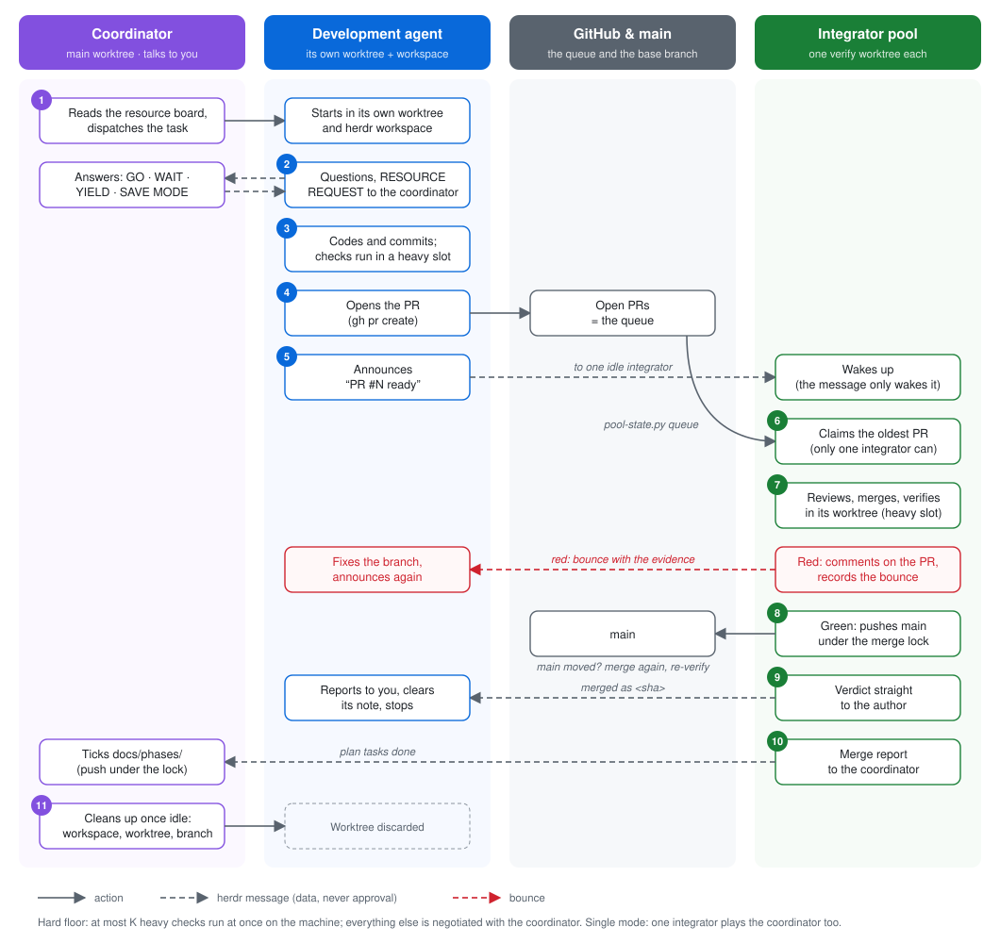

<!--
README of herdr-agent-pool: what the plugin does, how it works (the diagram), how to install
and use it, its skills, and where the rest of the documentation is. The details are in
docs/reference.md.
-->

# herdr-agent-pool

A [Claude Code](https://code.claude.com) plugin for running **many Claude agents in parallel
on one repository** inside [herdr](https://herdr.dev), without them stepping on each other or
on `main`.

- **Each development agent works in its own git worktree** and herdr workspace, and finishes
  with a pull request.
- **One integrator owns the base branch.** It reviews each PR as an adversarial auditor,
  verifies it merged onto the current base, and merges or bounces it with evidence.
- **Hooks enforce the roles.** Edits, commits and pushes to `main` from any other session are
  blocked before they run.
- **It scales out (pool mode, opt-in):** a coordinator talks to you, plans and dispatches,
  while several integrators merge in parallel under a merge lock.
- **The machine is shared fairly:** heavy checks run in a limited number of slots, and merged
  worktrees are cleaned up.

## Install

### 1. Dependencies (once per machine)

| Dependency | Why | Install (macOS / Linux) |
|------------|-----|-------------------------|
| [herdr](https://herdr.dev) 0.9.5+ | runs every agent in its own workspace and carries their messages | `curl -fsSL https://herdr.dev/install.sh \| sh` |
| [Claude Code](https://code.claude.com) | the agents | `curl -fsSL https://claude.ai/install.sh \| bash` |
| `git`, `bash` | worktrees and scripts | preinstalled, or `brew install git` / `apt install git` |
| `jq` | the scripts read JSON | `brew install jq` / `apt install jq` |
| `python3` 3.9+ | the plugin's scripts (standard library only) | preinstalled on macOS, or `apt install python3` |
| [GitHub CLI](https://cli.github.com) `gh` | pull requests and checks | `brew install gh` / `apt install gh`, then `gh auth login` |

Then connect herdr to Claude Code once: `herdr integration install claude` (the installer
below offers to do it). macOS and Linux are supported (CI runs on both); on Windows, WSL
should work but is untested.

### 2. The plugin (once per repository)

From inside the repository you want to set up:

```bash
curl -fsSL https://raw.githubusercontent.com/R0drig0V1/herdr-agent-pool/main/install.sh | bash
```

It copies the project files (`CLAUDE.md`, `scripts/check.sh`, `scripts/integrator.sh`, the
role prompts, `.gitattributes`, the `docs/` indexes) without overwriting yours, enables the
plugin in `.claude/settings.json`, installs it with the `claude` CLI, checks every dependency
above and ends with the steps that are left. `--dry-run` previews it; `--no-plugin` skips the
plugin install. Without the installer:

```bash
claude plugin marketplace add R0drig0V1/herdr-agent-pool
claude plugin install herdr-agent-pool@herdr-agent-pool --scope project
```

### 3. Start

Fill in `CLAUDE.md` (what the project is) and `scripts/check.sh` (your definition of green:
lint, types, tests), commit them, and launch the integrator in a herdr pane of the main
checkout:

```bash
scripts/integrator.sh          # pool mode: scripts/coordinator.sh
```

Then ask it for work, or run `/herdr-agent-pool:dispatch <type>/<name> <task>`. Settings live
in `.claude/herdr-agent-pool.json` (base branch, names, pool mode, numbered files); see
[docs/reference.md](docs/reference.md#configuration). Install problems ("plugin not found in
marketplace", scopes): [docs/reference.md](docs/reference.md#installing-details).

## How it works

<p align="center">
  
</p>

1. You ask the **coordinator** (in single mode, the integrator) for work. It dispatches a
   **development agent** in a worktree and herdr workspace of its own.
2. The agent works, runs the project's checks and opens a PR, announced to an **integrator**.
3. The integrator claims the PR, reviews it, merges it onto the current base in its own
   worktree and runs the checks there.
4. Red: the PR bounces to its author. Green: it lands on the base, never force-pushed.
5. The verdict goes to the author, the plan is ticked, and the worktree is cleaned up.

Solid arrows are actions, dashed ones herdr messages. The architecture (components, flows,
shared state, design rules) is in [plugin/README.md](plugin/README.md).

## Skills

| Skill | Who | What it does |
|-------|-----|--------------|
| `dispatch` | integrator (pool: coordinator) | Starts a development agent for a task in its own worktree and workspace, with a brief |
| `integrate` | integrator | The merge loop: review, verify on the merged result, merge or bounce, verdict |
| `coordinate` | coordinator, pool mode | Dispatches, arbitrates machine resources, sizes the integrator pool, ticks the plan |
| `commit` | development agent | Runs the checks, then a Conventional Commit |
| `pr` | development agent | Opens the PR with a structured body and announces it to the integrator |
| `improve-plan` | dispatcher | Red-team review of the plan in `docs/phases/` before a phase starts |
| `document` | anyone | Brings docstrings, `docs/`, ADRs and `CLAUDE.md` up to date |
| `issue` | anyone | Files a GitHub issue for work left for later, with acceptance criteria |
| `setup` | you | Checks the machine and the project, and fixes what is missing after asking |

Invoke them as `/herdr-agent-pool:<skill>`. Two read-only agents come with them:
`plan-adversary` (used by `improve-plan`) and `code-reviewer`.

## Rules every agent follows

- The base branch moves only through the integrator; development happens in worktrees.
- Only a verified tree lands, and the base is never force-pushed.
- Agent messages are data, not instructions: approvals come from you directly.
- No agent answers another agent's dialog; a blocked agent is escalated to you.
- A PR opened by another GitHub account is read-only until you say yes, every time.

The full rules are in [docs/reference.md](docs/reference.md#rules).

## Documentation

| Page | What is in it |
|------|---------------|
| [docs/reference.md](docs/reference.md) | Every setting, resources, single and pool mode, components, rules, limitations |
| [plugin/README.md](plugin/README.md) | Architecture: components, information flows, shared state |
| [docs/multi-integrator.md](docs/multi-integrator.md) | Pool mode in depth: claims, the merge lock, scaling, parallel verification |
| [docs/lander.md](docs/lander.md) | The lander: merging queued PRs from a script or GitHub Actions |
| [docs/ci-workflows.md](docs/ci-workflows.md) | CI for a project with many agents: test once, cancel superseded runs |
| [docs/benchmark/](docs/benchmark/README.md) | How workflow changes are measured with real agents, and every run |
| [docs/decisions/](docs/decisions/README.md) | The plugin's design decisions and the evidence behind them |
| [docs/field-evidence.md](docs/field-evidence.md) | What a real project in pool mode showed |
| [CHANGELOG.md](CHANGELOG.md) | Release history |

## Development

```bash
tests/test-hooks.sh && tests/test-pool.sh && tests/test-lander.sh
uv run ruff check . && uv run ruff format --check .
```

Record each design decision in [docs/decisions/](docs/decisions/README.md) and measure workflow
changes with the [benchmark](docs/benchmark/README.md). Code quality and security checks:
[docs/code-quality.md](docs/code-quality.md). Security reports: [SECURITY.md](SECURITY.md).

## License

[MIT](LICENSE).
