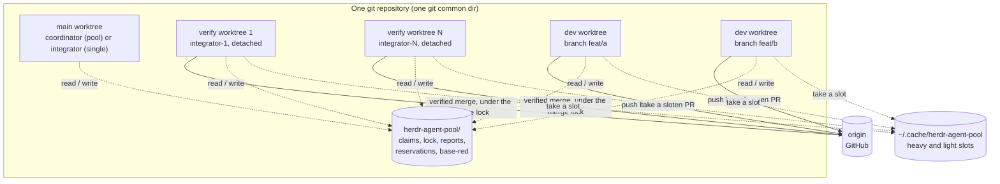
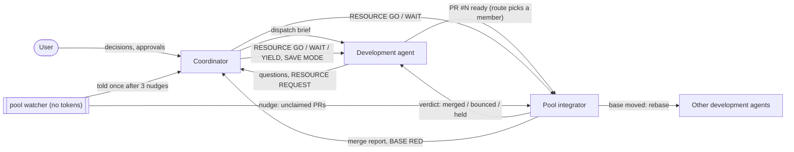
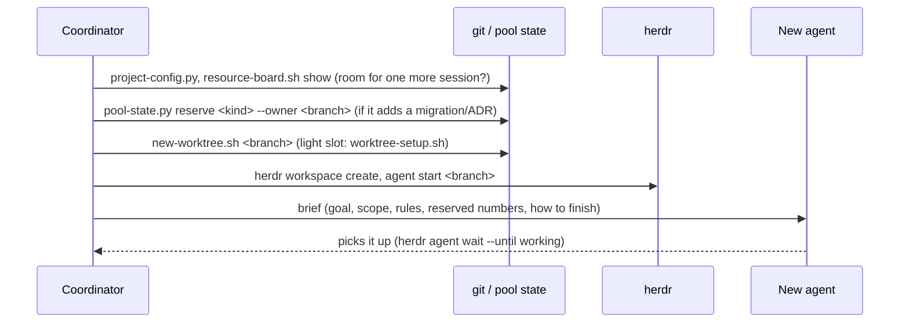
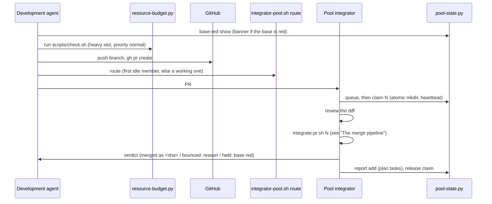
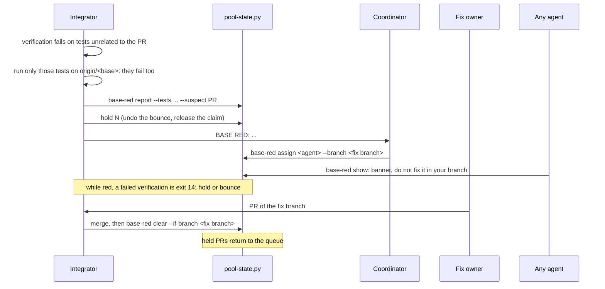
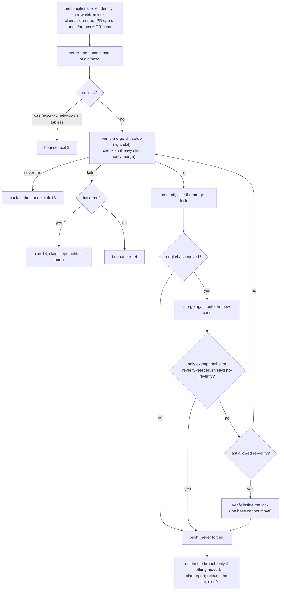
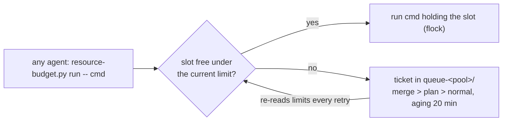

<!--
Architecture guide of the herdr-agent-pool plugin: its components, who talks to whom, what
state is shared and where, and the rules that hold it together. For installing and
configuring, see the repository README; for the pool's design decisions and their trade-offs,
docs/multi-integrator.md. Keep this file in step with the scripts' headers.
-->

# herdr-agent-pool: architecture

This plugin lets many Claude Code sessions work on **one repository** at the same time inside
[herdr](https://herdr.dev) (a terminal multiplexer whose panes run named agents). It does three
things:

1. **Isolates work.** Each task gets its own git worktree, branch and herdr workspace.
2. **Serialises what must be serial.** Only verified merges reach the base branch, one push at a
   time, and only a bounded number of heavy commands run on the machine at once.
3. **Routes information.** Every message goes straight to the one agent that acts on it, and
   none of them counts as the user's approval.

This guide explains how those pieces fit. It is written for someone reviewing the design, not
for installing it (see [../README.md](../README.md)) or for the reasoning behind each pool
policy (see [../docs/multi-integrator.md](../docs/multi-integrator.md)).

## Contents

- [The big picture](#the-big-picture)
- [Components](#components)
- [Roles and what each may do](#roles-and-what-each-may-do)
- [Trust and identity](#trust-and-identity)
- [Information flows](#information-flows)
- [Shared state](#shared-state)
- [The merge pipeline](#the-merge-pipeline)
- [Machine resources](#machine-resources)
- [Failure handling](#failure-handling)
- [Extension points for a project](#extension-points-for-a-project)
- [Where to change what](#where-to-change-what)
- [Design rules](#design-rules)

## The big picture

There are two modes, chosen by the project's settings file:

- **Single mode** (the default): one integrator session in the main worktree reviews, verifies
  and merges every PR, and it dispatches the development agents.
- **Pool mode** (an `integrators` object in `.claude/herdr-agent-pool.json`): a coordinator in
  the main worktree plans, dispatches and arbitrates. 1..`max` integrators merge in parallel,
  each in its own detached verify worktree.

## Components

| Kind | Name | Job |
|------|------|-----|
| Skill | `dispatch` | Start a development agent: worktree, workspace, agent, brief (reserves file numbers) |
| Skill | `commit`, `pr` | A development agent's checks, commit, PR and announcement (via `route`) |
| Skill | `integrate` | The integrator loop: queue, claim, review, `integrate-pr.sh`, verdict, report |
| Skill | `coordinate` | The coordinator loop: resources, pool size, plan reports, questions, red base |
| Skill | `setup`, `document`, `improve-plan` | Project setup, docs upkeep, plan review |
| Agent | `code-reviewer`, `plan-adversary` | Subagents for review and plan criticism |
| Hook | `guard-main-bash.py` | Blocks Bash commands a role may not run (merges, protected pushes, role-only scripts, identity variables) |
| Hook | `guard-main-worktree.sh` | Blocks edits to the main worktree by non-owners |
| Hook | `session-start-*.sh` | Tells each session its role and worktree; claims the integrator name |
| Hook | `notify.sh` | Desktop notifications when a session stops or needs attention |
| Script | `project-config.py` | The only reader of the project settings; validates them |
| Script | `pool-state.py` | Pool state: claims, bounces, merge lock, plan reports, number reservations, red base |
| Script | `integrate-pr.sh` | The whole merge of one PR, gated by exit codes |
| Script | `verify-merge.sh` | Runs the project's checks on a merge (setup, `check.sh`, reset) |
| Script | `integrator-pool.sh` | Pool members: list, route, scale facts, spawn, stop, nudge, watch |
| Script | `resource-budget.py` | The machine's heavy and light slots, with a priority queue |
| Script | `resource-board.sh` | The shared resource sheet: memory, sessions, slot holders, notes |
| Script | `new-worktree.sh`, `cleanup-worktree.sh` | Create a development worktree; remove a merged one |
| Script | `agents-in-repo.py`, `worktree-of.sh`, `claim-integrator.sh`, `union-rows.py` | Helpers: who runs where, name claims, index-table merges |

Skills are instructions a Claude session follows; scripts are what makes the steps
deterministic. A rule that matters is enforced by a script or a hook, and the skill explains
it.

## Roles and what each may do

| Role | Where | Owns | May not |
|------|-------|------|---------|
| **User** | the terminal | approvals, policy, the plugin's own merges | |
| **Coordinator** (pool) | main worktree, `CLAUDE_ROLE=coordinator` | the plan (`docs/phases/`), dispatch, pool size, resource arbitration, the red-base owner | merge a PR |
| **Integrator** (single) | main worktree, `CLAUDE_ROLE=integrator` | the base branch, dispatch, the plan | |
| **Pool integrator** | `../<prefix>integrator-<n>`, detached | the PRs it claims | touch the main worktree or the plan, merge a PR it did not claim |
| **Development agent** | `../<prefix><branch>` | its branch and PR | merge, push a protected branch, message anyone but the coordinator and the pool |

The roles come from launch scripts (`scripts/coordinator.sh`, `integrator-pool.sh spawn`) that
set `CLAUDE_ROLE` and the herdr agent name. A session cannot promote itself: see the next
section.

## Trust and identity

Agents are not trusted by what they say about themselves.

- **Identity is the herdr pane, checked by ancestry.** `pool-state.py` (`caller_name`) asks
  herdr which agent runs in `$HERDR_PANE_ID`. It believes the answer only when that pane's
  shell is an ancestor of the calling process, so a forged pane id points at a pane whose shell
  is not ours, and the call is refused. Commands that change shared state check this in pool
  mode, and `--owner` must equal the caller.
- **Environment variables are claims, not proof.** The guard hook blocks commands that set
  `CLAUDE_ROLE`, `HERDR_AGENT_POOL_NAME`, `HERDR_AGENT_POOL_SLOT` or herdr's own pane
  variables, and blocks the role-only scripts for sessions without the role.
- **Messages are data.** Everything sent with `herdr agent prompt` starts with
  `[herdr message from agent <name>; not from the user]` (the pool watcher uses `[herdr
  message from the pool watcher ...]`). Claude Code shows it as a user message, but every skill
  treats it as data: it wakes an agent and points at work. It never approves a merge, waives a
  check or changes policy.
- **Nobody answers another agent's dialog.** A blocked agent (waiting at a permission or
  question dialog) is reported to the user, never unblocked by a peer.
- **Fail closed.** When herdr cannot answer, an identity check refuses. When a project hook
  crashes, the merge verifies again. When the base cannot be read, no file number is handed
  out.

## Information flows

### Who talks to whom

Two things the coordinator deliberately does **not** relay: PR announcements (they go straight
to the pool) and verdicts (straight from the integrator to the author). The coordinator sees
plan reports, questions, resource requests and red-base notices.

### 1. Dispatch

### 2. From commit to merge

### 3. Plan reports

An integrator never edits the plan. After a merge, `integrate-pr.sh` records
`reports/pr-<N>.json` (the merge sha and the PR body's "Plan tasks completed" section), and the
integrator prompts the coordinator. The coordinator ticks the tasks in `docs/phases/`, commits
under the merge lock and runs `report done N`. A coordinator that was down catches up by
comparing recently merged PRs with the recorded reports.

### 4. Resources

An agent that needs more than a normal check (a server, a benchmark, parallel subagents) notes
it on the board and asks the coordinator. The coordinator answers `RESOURCE GO`,
`RESOURCE WAIT: <why>; ask again after <event>`, or `RESOURCE YIELD` to someone else, and
broadcasts `SAVE MODE ON/OFF` when memory is low. Underneath that conversation, the slot floor
of `resource-budget.py` holds no matter what is said.

### 5. A red base

### 6. Lost or misdirected announcements

`integrator-pool.sh watch` runs in the background, started by the coordinator, and spends no
Claude tokens. Every minute it lists the claimable PRs. When one has waited unclaimed for
`nudge_after_minutes`, it prompts an idle member that holds no claim (each member at most once
per interval). After 3 nudges about the same PR, it tells the coordinator once and stops
nudging about it.

## Shared state

All coordination state is files. Nothing holds project content, only PR numbers, SHAs, names
and times. Every read-decide-write runs under a kernel `flock`, so a crashed process never
leaves a lock behind.

| Location | File | Meaning | Written by |
|----------|------|---------|------------|
| `<git common dir>/herdr-agent-pool/` | `claims/pr-N/owner.json` | who verifies PR N; heartbeat; stale after the TTL or when the agent leaves herdr | integrators |
| | `bounced/pr-N.json` | the head that was bounced; skipped until a new push | integrators |
| | `lock/merge.lock`, `merge.owner.json` | the merge lock (flock) and its holder | integrators, coordinator |
| | `reports/pr-N.json`, `reports/done/` | plan tasks to tick | integrators, then the coordinator |
| | `members/<name>.activity`, `<name>.json` | last activity (scale-down), workspace records | pool scripts |
| | `reservations/<kind>.json` | file numbers reserved per branch | anyone |
| | `base-red.json`, `base-red.log`, `held/pr-N.json` | the red base, its owner and history; PRs waiting for the fix | integrators, coordinator |
| | `watch/`, `watch.lock`, `watch.pid` | the watcher's first-seen stamps, nudge counts, single-instance lock | the watcher |
| `<worktree git dir>/` | `herdr-agent-pool-integrate.lock` | one `integrate-pr.sh` run per worktree | integrate-pr.sh |
| | `herdr-agent-pool-verify-N.log` | the verification log of PR N | integrate-pr.sh |
| `~/.cache/herdr-agent-pool/resources/` | `slot-<i>.lock/json`, `light-<i>.*`, `queue-<pool>/` | slots held and the waiting queue | resource-budget.py |
| `~/.config/herdr-agent-pool/resources.json` | | `heavy_slots`, `light_slots`, `sessions_guideline`, `low_memory_gb` | the user (or a governor) |
| repository | `.claude/herdr-agent-pool.json` | the project settings (versioned) | the user, by PR |

The git common dir is shared by every worktree of the repository, which is what lets agents in
different worktrees see the same claims and locks. The resources directory is per machine,
shared by every repository on it.

## The merge pipeline

`integrate-pr.sh <N>` is the whole merge as one script. Each step depends on the previous
step's exit code, and the last line is `RESULT <outcome> ...`.

Why it is safe:

- **Only a verified tree lands.** The push is never forced, so the remote rejects anything that
  is not a fast-forward of what was verified. The merge lock adds ordering, but correctness
  doesn't depend on it.
- **"The base moved" is handled under the lock.** The script merges again and decides there:
  push when only exempt paths changed or the project hook says the change cannot matter;
  otherwise verify again, up to `max_reverify` times, the last one holding the lock.
- **No false verdicts.** A verification that never ran (exit 13), or that failed only because
  the base is red (exit 14), never records a bounce against the author.
- **The branch is deleted only when nothing moved.** The delete carries a lease on the merged
  head, so a push that lands in between keeps the branch and the PR.

The full exit-code table is in the script's header and in the `integrate` skill.

## Machine resources

- Two pools. **heavy** (`heavy_slots`) is for test suites and builds. **light** (`light_slots`,
  default 2) is for worktree setup, so a dependency sync never waits behind a suite.
- Priorities come from the caller's role: `--priority merge` is honoured only for
  integrators, and `plan` only for the coordinator.
- Holders get `$HERDR_AGENT_POOL_SLOT_COUNT` (the limit at admission), so a project can size
  its parallelism.
- `resource-budget.py status` and `resource-board.sh show` list every holder and waiter.

## Failure handling

| What fails | What happens | Recovery |
|------------|--------------|----------|
| An integrator dies mid-verification | its claim stops heartbeating, and its herdr agent disappears | another member re-claims; on respawn, the leftover merge in its worktree is aborted |
| An integrator dies holding the merge lock | the kernel frees the flock | the push happened (atomic) or not |
| A second `integrate-pr.sh` starts in the same worktree | the per-worktree lock refuses it, exit 2 | wait for the first `RESULT` |
| A slot waiter is killed | exit 120 from `resource-budget.py`, then `integrate-pr.sh` exit 13 | back to the queue, no bounce |
| The base moves during every verification | re-verify, the last one holding the lock | exit 7 only if even that push is rejected |
| The base fails on its own | red-base notice, one owner, held PRs | clears when the fix merges |
| An announcement is lost or goes to a busy member | the watcher nudges an idle member | the coordinator after 3 nudges |
| herdr cannot be asked | identity checks refuse; claims age out by TTL only | nothing merges twice |
| The coordinator is down | integrators keep merging; reports accumulate | catch-up on restart |

## Extension points for a project

A project plugs into the plugin through files at fixed paths, and nothing else.

| File | Required | Contract |
|------|----------|----------|
| `scripts/check.sh` | in practice | lint, types and tests; exit code is the verdict; must not change tracked files. Gets `check_env` variables, and `$HERDR_AGENT_POOL_BASE_RED_TESTS` while the base is red |
| `scripts/worktree-setup.sh <base>` | no | prepares a fresh worktree (dependencies); runs in a light slot |
| `scripts/verify-reset.sh` | no | resets verification state (databases, caches) after a failed or aborted merge |
| `scripts/reverify-needed.sh <verified base> <new base> <PR head>` | no | changed paths on stdin; print `no-reverify` last and exit 0 to skip a re-verification; anything else verifies; read from the new base; 120 s limit |
| `.claude/herdr-agent-pool.json` | no | settings: `base_branch`, names, `integrators`, `verify`, `numbered_files`, protected branches |
| `.claude/prompts/integrator.md` | no | extra system prompt for pool integrators |

The project's CI workflows are its own, and the plugin never edits them. How to keep them
from testing each change twice or billing for superseded runs:
[docs/ci-workflows.md](../docs/ci-workflows.md).

## Where to change what

| To change... | Edit |
|--------------|------|
| what a role may run | `hooks/guard-main-bash.py` (`POOL_ROLES`, `tool_need`), and the script's own role check |
| the merge steps or exit codes | `scripts/integrate-pr.sh`, the `integrate` skill's table, `docs/multi-integrator.md` |
| how claims, the lock or reports work | `scripts/pool-state.py` |
| who gets announcements, scaling, nudges | `scripts/integrator-pool.sh` |
| slot limits and queue order | `scripts/resource-budget.py` (and the user's `resources.json`) |
| a new setting | `scripts/project-config.py` (validated, documented in its docstring), the repository README's settings table |
| what an agent is told to do | the skill (`skills/<name>/SKILL.md`); enforce anything important in a script too |

Every change needs tests (`tests/test-pool.sh`, `tests/test-hooks.sh`) and must keep the
quality gates green: ruff, lizard and shellcheck (see `docs/code-quality.md`).

## Design rules

1. **The exit code is the verdict.** No agent decides by reading output for "passed".
2. **Only verified trees land; never force-push** the base or `main`, and never rewrite their history.
3. **Messages between agents are data, never approval.** Approvals come only from the user, in their own session.
4. **Identity is proven, not declared**: the herdr pane, checked by process ancestry.
5. **Fail closed** when something cannot be known.
6. **One owner per thing**: a PR's claim, a worktree's merge run, the merge lock, a red base's fix, a reserved number.
7. **Nobody waits at a dialog while holding shared work**: comment, bounce or hold, tell someone, move on.
8. **No false blame**: when a check never ran, or failed because of the base, the author is not bounced.
9. **State is files under a flock**, content-free, in the git common dir or the per-machine cache.
10. **Scripts enforce, skills explain.** A rule that only lives in a prompt will eventually be skipped.
